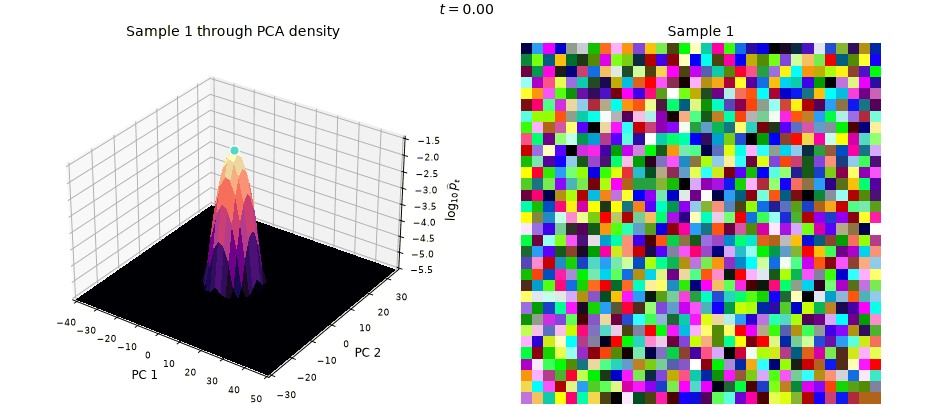

# Flow matching and rectified flow

Unconditional CIFAR-10 generation in JAX: learning a velocity field, following its trajectories, and making those trajectories straighter with reflow.



One sample through time. The surface shows the estimated log-density of generated states projected onto two principal components; the image shows the corresponding sample in pixel space.

## Velocity model

A [time-conditioned U-Net](model/model.py) with residual blocks, GroupNorm, SiLU, and skip connections. Spatial resolutions are $32\to16\to8\to16\to32$, with encoder widths $64,128,256$.

```math
\begin{aligned}
v_\theta(x,t)&=\mathrm{UNet}_\theta(x,e(t)),\\
e(t)&=\mathrm{MLP}_\theta\!\left(t,\sin 2\pi t,\cos 2\pi t,\sin 4\pi t,\cos 4\pi t\right).
\end{aligned}
```

The original model, extra-training control, and reflow model share this architecture.

## Flow matching

Independent Gaussian noise and images define linear training paths. Images are scaled to $[-1,1]$, with $d=32\cdot32\cdot3$.

```math
\begin{gathered}
x_0\sim\mathcal N(0,I),\qquad x_1\sim p_{\mathrm{data}},\qquad t\sim U[0,1],\\
x_t=(1-t)x_0+tx_1.
\end{gathered}
```

```math
\begin{gathered}
\mathcal L_{\mathrm{FM}}(\theta)
=\mathbb E\!\left[\frac{\|v_\theta(x_t,t)-(x_1-x_0)\|_2^2}{d}\right],\\
\dot x_t=v_\theta(x_t,t).
\end{gathered}
```

The optimal field averages the target velocities at each state: $v^*(x,t)=\mathbb E[x_1-x_0\mid x_t=x]$. Its generated trajectories can curve even though each training pair defines a straight line. [Flow Matching for Generative Modeling](https://arxiv.org/abs/2210.02747).

## Reflow

The trained model supplies coupled noise–endpoint pairs. A second model starts from its weights and learns the straight paths connecting those pairs. [Flow Straight and Fast](https://arxiv.org/abs/2209.03003).

```math
\begin{gathered}
z_0\sim\mathcal N(0,I),\qquad z_1=\Phi_\theta(z_0),\\
z_t=(1-t)z_0+tz_1.
\end{gathered}
```

```math
\mathcal L_{\mathrm{reflow}}(\phi)
=\mathbb E\!\left[\frac{\|v_\phi(z_t,t)-(z_1-z_0)\|_2^2}{d}\right],
\qquad \phi\leftarrow\theta.
```

Here $\Phi_\theta$ is the original model's 128-step Heun integration. Sampling the reflow model in one Euler step gives $\hat x_1=z_0+v_\phi(z_0,0)$.

## Results

One round of reflow reduces **one-step integration error by 6.0×** and **path deviation by 6.5×** in this run.

| Model | One-step endpoint RMSE | Integrated path deviation |
|:--|--:|--:|
| Original | 0.4555 | 0.06016 |
| Extra training | 0.4589 | 0.05769 |
| Reflow | **0.0760** | **0.00932** |

Endpoint error is the median per-image RMSE to each model's own 128-step Heun reference, over 256 shared noise samples. Path deviation integrates the RMSE to the straight start–end chord, then takes the median over 32 trajectories.

Reflow and the extra-training control each receive 576 additional optimizer updates. Reflow also requires teacher-pair generation: 125.4 seconds in this run.

Against the **original model's endpoint**, one-step reflow has median RMSE **0.0848**, compared with **0.1026** for 16-step sampling of the original. Warmed A100 latency is **4.59 ms versus 54.47 ms per 64 images**, an **11.9× sampling speedup** at these settings.

The distribution gap remains: mean raw-pixel sliced Wasserstein distance to two real-data batches is **0.1166** for one-step reflow and **0.1105** for the original at 64 steps; the distance between the two real batches is **0.0785**. These measurements come from one training run.

## Notebooks

| | Method | Analysis |
|:--|:--|:--|
| Flow matching | [Loss, training, generation](flow_matching.ipynb) | [Densities, trajectories, spectra, class representations](analysis.ipynb) |
| Rectified flow | [Teacher pairs and reflow](rectified%20flow/rectified_flow.ipynb) | [Controls, straightness, numerical error, sampling speed](rectified%20flow/rectified_flow_analysis.ipynb) |
